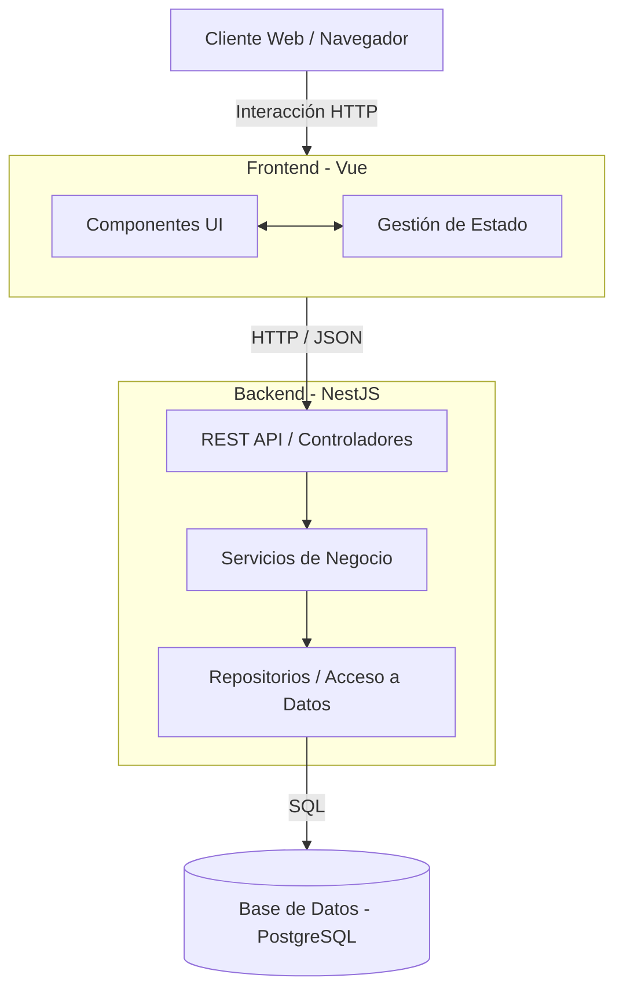

# Arquitectura de Personal Wallet

## Objetivo General de la Aplicación

El proyecto **Personal Wallet** tiene como objetivo proporcionar una solución para la gestión de finanzas personales. Permite a los usuarios registrar, organizar y visualizar sus ingresos, gastos y presupuestos, brindando una herramienta clara para mantener el control sobre su estado financiero de manera segura y eficiente.

## Principales Componentes

La aplicación está dividida en tres componentes fundamentales:

1. **Frontend (Cliente):** Interfaz de usuario desarrollada con **Vue**. Se encarga de la presentación de los datos y la interacción directa con el usuario.
2. **Backend (API Server):** Servidor desarrollado con **NestJS**. Maneja la lógica de negocio, autenticación, validación de reglas de negocio y procesa las peticiones del cliente.
3. **Database (Persistencia):** Base de datos relacional **PostgreSQL**, encargada de almacenar de forma segura y consistente toda la información financiera y de usuarios.

## Diagrama de Arquitectura



## Flujo de Comunicación

1. El usuario interactúa con la interfaz gráfica construida en **Vue** (Frontend).
2. El Frontend agrupa la información requerida y realiza peticiones HTTP (generalmente REST) hacia el **Backend**.
3. El Backend (NestJS) recibe la solicitud en la capa de controladores, donde se validan los datos de entrada.
4. El controlador delega la operación a la capa de servicios, donde se ejecuta la lógica de negocio correspondiente.
5. El servicio se comunica con la capa de repositorios para leer o escribir datos.
6. El repositorio ejecuta consultas SQL contra **PostgreSQL** para persistir o recuperar la información.
7. La base de datos responde al repositorio, y la respuesta viaja de regreso pasando por las capas hasta llegar al cliente, que actualiza la interfaz de usuario en consecuencia.

## Arquitectura Interna del Backend

Para mantener el código ordenado y escalable, el backend de NestJS está estructurado siguiendo un patrón de arquitectura en capas (Layered Architecture):

```text
Frontend (Vue)
       ↓
Controllers
       ↓
Services
       ↓
Repositories
       ↓
Database (PostgreSQL)
```

### Responsabilidad de cada Capa

* **Controllers (Controladores):** Su única responsabilidad es recibir las peticiones HTTP del cliente, validar los datos de entrada (Payloads/DTOs) y retornar la respuesta HTTP adecuada. No deben contener lógica de negocio.
* **Services (Servicios):** Contienen toda la lógica de negocio de la aplicación. Orquestan validaciones complejas, cálculos y la comunicación con uno o múltiples repositorios u otros servicios.
* **Repositories (Repositorios):** Encapsulan la lógica de acceso a la base de datos. Los servicios utilizan los repositorios sin necesidad de saber cómo se está almacenando la información internamente (abstracción).

### Razones y Beneficios de esta Separación

* **Separación de Responsabilidades:** Cada componente hace una sola cosa. Si cambia la forma de acceder a la base de datos, solo se modifica el Repositorio. Si cambia un endpoint de REST a GraphQL, solo cambia el Controlador.
* **Bajo Acoplamiento:** Las capas superiores dependen de interfaces o inyecciones de las capas inferiores, no de implementaciones concretas, facilitando intercambiar partes del sistema.
* **Facilidad de Mantenimiento:** Al estar el código organizado de forma predecible y estandarizada, un nuevo desarrollador puede ubicar rápidamente dónde corregir un bug o agregar una funcionalidad.
* **Testabilidad:** Al estar la lógica de negocio aislada en la capa de Servicios, es sumamente fácil realizar pruebas unitarias (Unit Tests) inyectando Repositorios falsos (Mocks) sin necesidad de levantar una base de datos real.
* **Posibilidad de Evolución Futura:** Esta estructura permite el crecimiento orgánico de la aplicación, soportando el agregado de nuevas entidades y reglas complejas sin que el código base se vuelva espagueti.
