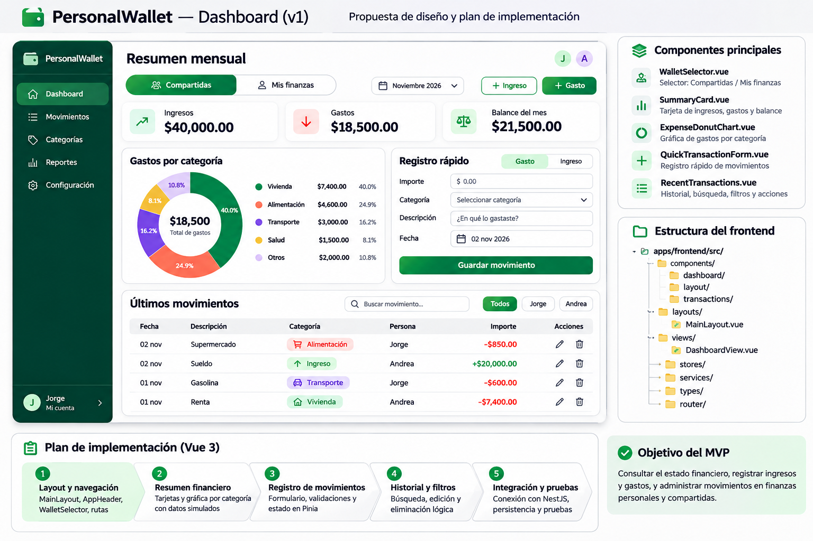

# Dashboard — PersonalWallet

**Versión:** 1.0  
**Estado:** Diseño aprobado, pendiente de implementación  
**Tecnología:** Vue 3 + TypeScript + Tailwind CSS

## Objetivo

Permitir que los dos usuarios autorizados consulten sus ingresos, gastos y balance mensual, administrando por separado sus finanzas personales y compartidas.

## Referencia visual

La imagen representa el diseño objetivo. Los importes son datos simulados y no corresponden a información financiera real.

## Componentes principales

| Componente | Responsabilidad |
|---|---|
| AppHeader | Logo y usuario autenticado |
| WalletSelector | Cambiar entre finanzas personales y compartidas |
| SummaryCard | Mostrar ingresos, gastos y balance |
| ExpenseDonutChart | Mostrar gastos por categoría |
| QuickTransactionForm | Registrar ingresos y gastos |
| RecentTransactions | Consultar, buscar y administrar movimientos |

## Reglas funcionales

1. El usuario puede alternar entre su wallet personal y la compartida.
2. El mes seleccionado determina el periodo de consulta.
3. Los ingresos, gastos y balance se calculan según la wallet y el mes.
4. El formulario registra el movimiento en la wallet seleccionada.
5. El usuario autenticado se identifica automáticamente.
6. Los importes se muestran exclusivamente en MXN.
7. Los movimientos eliminados lógicamente no aparecen en los resultados ni en los totales.
8. El filtro por persona solo aparece en finanzas compartidas.
9. Los movimientos pueden editarse y eliminarse, previa autorización.
10. La interfaz debe adaptarse a escritorio y móvil.

## Elementos excluidos de v1

- Frase promocional en el encabezado.
- Integración con Telegram.
- Selector manual de persona en el formulario.
- Columna de origen del movimiento.
- Reparto automático de gastos compartidos.

## Criterios de aceptación

- Cambiar de wallet actualiza tarjetas, gráfica e historial.
- Cambiar de mes actualiza los resultados.
- Se pueden registrar ingresos y gastos con validaciones.
- La búsqueda filtra movimientos por descripción.
- Los movimientos se pueden editar y eliminar lógicamente.
- La interfaz funciona correctamente en dispositivos móviles.
- Las pruebas pertinentes pasan sin errores.

## Implementación

La primera versión del frontend utilizará datos simulados y Pinia. Posteriormente se conectará a la API NestJS, donde se aplicarán las reglas de autenticación y autorización.

## Referencias

- ADR-002: Vue 3.
- ADR-003: NestJS.
- ADR-005: Finanzas personales y compartidas.
- ADR-006: Eliminación lógica.

## Avance de implementación

La primera etapa incorpora MainLayout, AppHeader, WalletSelector y DashboardView, con navegación a /dashboard y wallets simuladas en Pinia. El resumen financiero, el formulario, las gráficas, el historial y la autenticación siguen pendientes. El selector cambia el contexto visible; todavía no existen consultas ni movimientos que actualizar.
